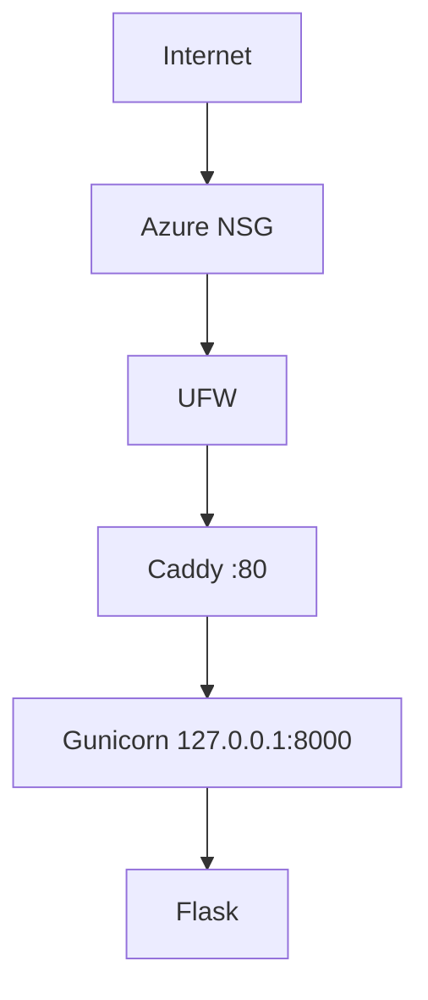

# Architecture v0.1

## Deployment View

## Resource Constraints
- 2 vCPU
- sekitar 1 GB RAM
- 62 GB disk

## Security Decisions
- non-root administration
- SSH key authentication
- SSH password login disabled
- UFW enabled
- backend loopback-only

## Current Limitations
- HTTP only
- single VPS
- no database
- no container
- no CI/CD

## Planned Evolution
- M04 DNS + HTTPS
- M05 persistent data
- M06 container
- M07 IaC
- M09 CI/CD
